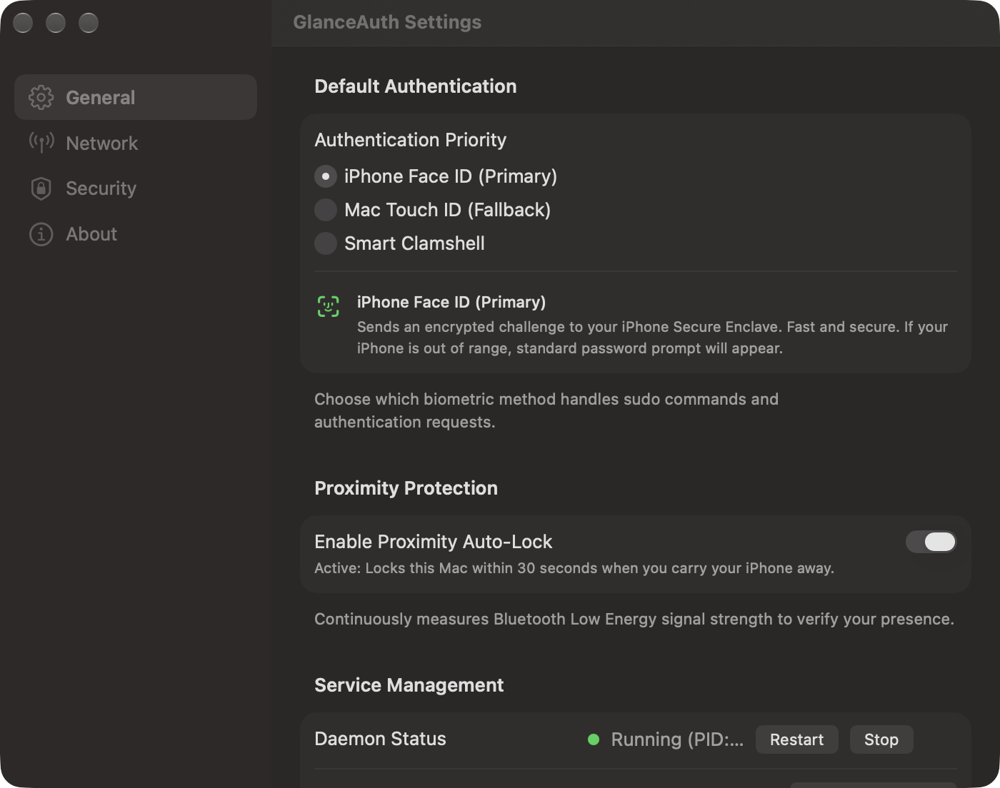
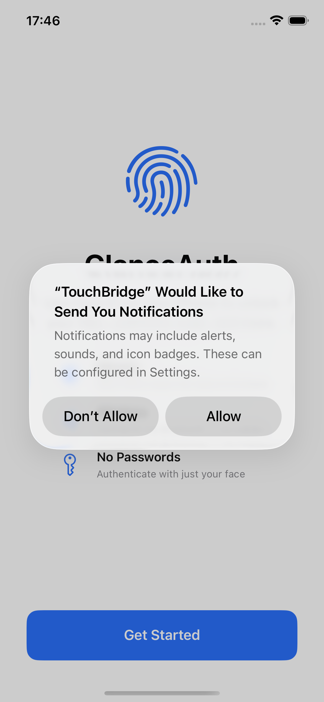

  <h1 align="center">GlanceAuth</h1>
  

    <strong>Unlock and authenticate your Mac with your iPhone's Face ID.</strong> 
    Works in clamshell mode, with external monitors, and across all macOS terminal & system prompts.
  

  

    
    &nbsp;
    
    &nbsp;
    
  

  

    
    &nbsp;
    
    &nbsp;
    
    &nbsp;
    
    &nbsp;
    
  

---

## Previews

  <table>
    <tr>
      <td align="center" width="62%" valign="middle">
        
         
        <b>macOS Settings</b>: Smart clamshell routing, proximity auto-lock, and BLE diagnostics
      </td>
      <td align="center" width="38%" valign="middle">
        
         
        <b>iOS Companion</b>: Hardware Face ID verification
      </td>
    </tr>
  </table>

---

## Why GlanceAuth?

If you dock your MacBook or use an external keyboard and monitor, you already know the frustration:

| Pain Point | Built-in Mac Touch ID | Apple Watch Unlock | GlanceAuth |
| :--- | :---: | :---: | :---: |
| **Works with MacBook Lid Closed (Clamshell)** | ❌ (Keyboard hidden) | ⚠️ (Inconsistent) |  **Auto-routes to Face ID** |
| **Authenticates `sudo` in Terminal** | ❌ (Must type password) | ❌ (Requires PAM hacks) |  **Instant Face ID prompt** |
| **Works with External Mechanical Keyboards** | ❌ (No Touch ID key) | ⚠️ (Only login screen) |  **Authenticates in 0.2s** |
| **Proximity Auto-Lock** | ❌ (Manual lock only) | ❌ (Not supported) |  **Locks when you walk away** |
| **Cost / Hardware Requirement** | Requires built-in sensor | Requires $400 Apple Watch |  **Uses phone you already own** |

---

## Key Features

- **Instant Face ID for macOS**: Approve `sudo`, screensaver unlock, and authentication dialogs with a glance.
- **Smart Clamshell Routing**: Automatically detects your MacBook lid state — routes challenges to iPhone Face ID when closed or docked with external monitors, and uses Mac Touch ID when open.
- **Proximity Auto-Lock**: Measures Bluetooth Low Energy (BLE) signal strength and automatically locks your Mac within 30 seconds when you carry your iPhone away.
- **Dual Transport Failover**: Seamless zero-latency transition between Bluetooth Low Energy (BLE) and Local Network Wi-Fi without dropped sessions.
- **100% Private & Offline**: No cloud servers, no account registration, and zero analytics.

---

## Security & Architecture

> [!IMPORTANT]
> **Hardware-Backed Protection**: GlanceAuth generates cryptographic P-256 ECC keys directly inside your iPhone's **Secure Enclave**.
> - **Biometrics never leave the phone**: Face ID verification happens locally on your device's hardware chip.
> - **Zero knowledge on Mac**: The Mac only receives an encrypted cryptographic signature verifying that your Face ID was approved.
> - **Session Encryption**: Every request uses ephemeral ECDH key agreement with AES-256-GCM encryption.

---

## Quick Setup Guide (5 Minutes)

### 1. Install on Your Mac
1. Download **[GlanceAuth-2.2.0.dmg](https://github.com/aymanysr/GlanceAuth-Releases/releases/latest/download/GlanceAuth-2.2.0.dmg)**.
2. Drag **`GlanceAuth.app`** into your **`Applications`** folder.
3. Double-click **`GlanceAuth-2.2.0.pkg`** inside the DMG to install the background service.
4. **First Launch (One-Time Gatekeeper Approval)**:
   - Right-click `GlanceAuth.app` in Applications → click **Open** → click **Open** in the dialog.
   - GlanceAuth will appear in your Mac menu bar.

### 2. Install on Your iPhone (At Home via Sideloadly)
*Zero jailbreak or special profiles required.*

1. Download the free desktop utility **Sideloadly** on your Mac from [sideloadly.io](https://sideloadly.io).
2. Connect your iPhone to your Mac via USB (tap "Trust This Computer" if asked).
3. Download **[GlanceAuth-2.2.0.ipa](https://github.com/aymanysr/GlanceAuth-Releases/releases/latest/download/GlanceAuth-2.2.0.ipa)**.
4. In Sideloadly:
   - Drag `GlanceAuth-2.2.0.ipa` into the app icon box.
   - Enter your personal Apple ID email in the "Apple ID" box (used only to sign the certificate locally).
   - Click **Start**. The app will install onto your iPhone in seconds!
5. **One-Time Trust**: On your iPhone, go to **Settings → General → VPN & Device Management → Developer App → Trust**.

### 3. Wireless Pairing
*Disconnect your USB cable — it is never needed again!*

1. On iPhone: In **Settings → GlanceAuth**, ensure **Bluetooth**, **Face ID**, and **Background App Refresh** are all **ON**.
2. On Mac: Click the GlanceAuth menu bar icon and select **"Re-pair Phone / Show QR..."**.
3. On iPhone: Open GlanceAuth and tap **"Scan QR Code"**.
4. Point the camera at the Mac screen. The status turns **Green: "Ready — phone connected"**!

---

## Updating to Newer Versions

When an update is released:
- On Mac: Download the new `.dmg` and replace `GlanceAuth.app` in `/Applications`.
- On iPhone: Drop the new `.ipa` into Sideloadly and click Start.
- **All pairing is preserved**: iOS performs an in-place update. You do **not** need to re-pair or re-scan the QR code.

---

## Feedback & Bug Reports

Found an issue or have a feature request? Please open an issue on the [GitHub Issues](https://github.com/aymanysr/GlanceAuth-Releases/issues) tab!

---

## License

GlanceAuth is closed-source freeware. All rights reserved. Third-party open-source notices are bundled in the distribution.
